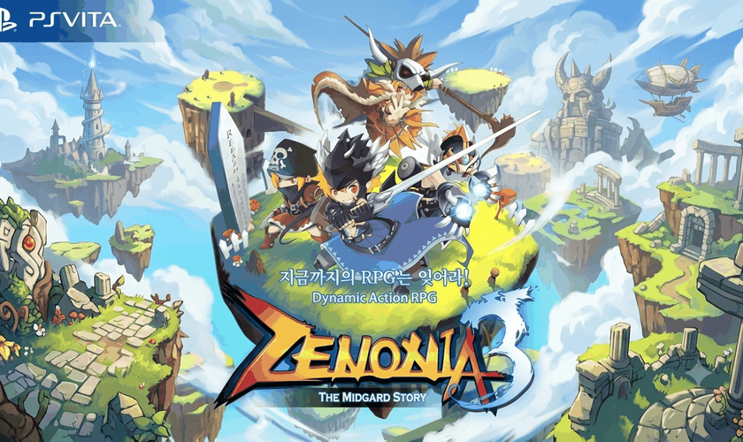

<h1 align="center">
  <br>
  Zenonia 3 · PS Vita Port
</h1>

<p align="center">
  <b>Native port of Zenonia 3 (Gamevil) for PlayStation Vita and PlayStation TV.</b>
</p>

<p align="center">
  
  
  
  
  
  
</p>

<p align="center">
  <a href="#-description">Description</a> •
  <a href="#-features">Features</a> •
  <a href="#-controls">Controls</a> •
  <a href="#-installation">Installation</a> •
  <a href="#-known-issues">Known Issues</a> •
  <a href="#-building-from-source">Build</a> •
  <a href="#-credits">Credits</a>
</p>

---

## 📖 Description

**Zenonia 3** is the Gamevil action RPG, originally released for Android. This repository contains a loader of
**the Android release of Zenonia 3**, based on the [Android SO Loader by TheFloW][gtasa]. The loader provides a
tailored, minimalistic Android-like environment to run the official ARMv6 game executable (`libgameDSO.so`) on the
PS Vita, with [vitaGL](https://github.com/Rinnegatamante/vitaGL) for rendering and FalsoJNI for the Java side.

The game uses the same Gamevil Nexus2 engine family as the sibling Zenonia 2 port. Nothing from the game is
distributed here; you need your own copy of the APK.


## 🎮 Status & Playability

**Status: Playable (beta) (VPK 01.00)** — the game was confirmed running on a real PS Vita: full screen, Gamevil logo,
character selection, the intro cutscene and stable gameplay with the buttons (Triangle = Skip, Cross = attack).
Text, audio, touch, saves and the newer options are still being verified one by one on the console.

- [x] **Loader**: boots the original `libgameDSO.so` with the soloader and FalsoJNI. *Verified on console.*
- [x] **Graphics**: full-screen rendering, Gamevil logo, title, main menu and About / Help pages. *Verified on console.*
- [x] **Gameplay**: character selection, cutscene and stable gameplay with physical buttons. *Verified on console.*
- [x] **Black-screen fix**: the screen is drawn again with the softfp vitaGL build (`SOFTFP_ABI=1`). *Verified on console (2026-09-27).*
- [ ] **Text, audio, touch and saves**: implemented, console verification pending.
- [ ] **Translations (ES / PT)**: implemented, console verification pending (see Known Issues).
- [ ] **Start + Select options**: screen size, filter and FPS counter are new and not yet tested on console.

### 📜 Port history (summary)

The full bug-by-bug history is in [`port_progress.md`](port_progress.md). The main milestones were:

- **Startup**: libc / pthread crashes on Bionic static mutexes, a GFA font bridge without a registered implementation,
  and a map-loading abort caused by a signed compare on `0x81xxxxxx` addresses (patched at `text_base + 0x9a7b4`).
- **Display**: the engine draws at 400×240 internally, not 800×480; the loader scales it to the Vita's 960×544.
- **Text and UI**: real text rendering with `stb_truetype` (`loader/font.c`), and the logo, title and menu
  overlays that the Android UI draws in Java (`androidui/*.rgba`).
- **Audio and touch**: an audio path adapted from Zenonia 2, touch coordinates in game space, and bionic `struct stat`
  layout fixes for save loading.
- **Black screen**: vitaGL vendored and built with `SOFTFP_ABI=1` (Fase 7).

### ✨ What works

- Full-screen rendering, Gamevil logo, title screen and menus.
- Character selection, the intro cutscene and gameplay with the physical buttons (Triangle = Skip, Cross = attack).
- Native RGB565 texture upload is the most stable rendering combination on hardware (see Performance below).

---

## ✨ Features

| Feature | Status | Notes |
| :--- | :---: | :--- |
| Boots to gameplay | ✅ | Logo, title, character selection and gameplay confirmed on console |
| Graphics / renderer | ✅ | Full screen (960×544), vitaGL with the softfp ABI |
| Audio & music | 🧪 | Port audio path implemented; console verification pending |
| Video / cutscenes | ✅ | Cutscene confirmed on console |
| Physical buttons | ✅ | Triangle = Skip, Cross = Attack confirmed; full mapping in [Controls](#-controls) |
| Analog sticks / camera | 🧪 | Left stick moves (always, whatever the D-pad bindings are); not separately confirmed |
| Touch screen | 🧪 | Touch in game coordinates; console verification pending |
| Button remapping / port menu | 🧪 | Start + Select menu: remap, frame rate, on-screen buttons, screen size, filter, FPS counter, language |
| Save data | 🧪 | `Save0.dat`; save and load without crash pending console verification |
| Native trophies | ➖ | No trophies in this port |
| Languages | 🧪 | English original; ES / PT translation pack pending console verification |
| Performance | 🟡 | 30 fps default, 22 fps option; the most stable build combination was confirmed on hardware (see Performance) |
| Online / IAP / ads | ➖ | No online features in this port |
| PS TV | 🧪 | Not tested yet |

Legend: `✅ Working (verified on console) · 🧪 Implemented, not yet verified on console · 🟡 Partial · ❌ Not working · ➖ Not applicable · ❔ Not documented yet`

---

## 🎯 Controls

|       Button        | Action                                  |
|:-------------------:|:----------------------------------------|
| ![dpadh] / Left stick | Move Left / Right                     |
| ![dpadv] / Left stick | Move Up / Down                        |
|      ![cross]       | Action / Attack / OK                    |
|      ![circl]       | Back / Cancel / Menu                    |
|      ![squar]       | Map / Quick Item                        |
|      ![trian]       | Skip / Special                          |
|      ![trigl]       | Save                                    |
| ![start] + ![selec] | PS Vita options menu                    |
| ![trigr] + ![trigl] | Show / Hide on-screen buttons           |
| ![trigr] + ![selec] | Switch 30 / 22 fps                      |

### Main menu

The main menu (after the title screen) can be used with buttons: the d-pad or left stick moves a highlight (white
corners) over the six buttons, Cross presses the highlighted one. Touching the screen hides the highlight; the next
d-pad press brings it back.

### PS Vita options menu

Press **Start + Select** at any time (the game is paused underneath). From there:

- Remap every action: Cross replaces the buttons of the highlighted action, Square adds one more, Triangle leaves
  it unbound. A button can only belong to one action, so it is taken off the previous one. The left stick always
  moves, whatever the D-pad bindings are.
- Frame rate: 30 fps (default) or 22 fps (the speed the original Android game runs at).
- On-screen buttons: Hidden (0% opacity, default) or Visible (100%). Hidden buttons still respond to touch where
  they normally are.
- Screen size: Full screen (default) or Original (5:3, 906x544 with thin side bars). *(new, not yet tested on console)*
- Filter: Sharp (nearest, default) or Smooth (bilinear upscale). *(new, not yet tested on console)*
- FPS counter: top-left corner. *(new, not yet tested on console)*
- Text language: ENGLISH / ESPANOL / PORTUGUES (see below), applied instantly.
- Restore defaults.

Circle (or Start) saves and closes. Bindings go to `ux0:data/zenonia3/controls.txt`, the rest to `config.txt`; both
can also be edited by hand:

```ini
UP = UP
DOWN = DOWN
LEFT = LEFT
RIGHT = RIGHT
OK = CROSS
BACK = CIRCLE
SKIP = TRIANGLE
MAP = SQUARE
SAVE = L1
```

Buttons: `CROSS`, `CIRCLE`, `SQUARE`, `TRIANGLE`, `L1`, `R1`, `UP`, `DOWN`, `LEFT`, `RIGHT`, `SELECT` and `NONE`.

To quit, use the PS button.

### Text language

The **Text language** row (ENGLISH / ESPANOL / PORTUGUES, also `lang = EN|ES|PT` in `config.txt`) switches **everything
the game reads as text**: menus, items, skills, monsters, maps, quests, tips, popups, the story dialogue and the
Help/About pages (the PS Vita options menu itself follows too), **instantly, without restarting**. It needs the
translation pack: copy the `ux0` folder of `zenonia3_vita_traduccion_ES_PT.zip` to the root of `ux0:` (it creates
`ux0:data/zenonia3/assets/data/spa/` and `.../por/`; the English files are never modified). Missing files fall back
to English.

Accented letters (á é í ó ú ñ ü ç ã õ â ê ô à, ¿ ¡) are drawn by composing the game font's own base letter with an accent
made from the same font; set `accents = 0` in `config.txt` to show plain letters instead. Text drawn inside the game's
images (title buttons, some UI art) stays in English. Packs are generated with `scripts/zt1_lang.py` (`export`,
`build`, `test`, `zip`) from `zenonia3_translation/es|pt/`.

---

## 📋 Prerequisites

To run this port on your PS Vita or PS TV, you will need:

1. A PS Vita / PS TV on **Enso 3.60 or 3.65** firmware (recommended). Other versions may work but are not supported.
   If you hit issues not listed in Known Issues, please upgrade or downgrade your firmware before asking for support.
2. [**kubridge**](https://github.com/bythos14/kubridge/releases/) and [**FdFix**](https://github.com/TheOfficialFloW/FdFix/releases/)
   (`kubridge.skprx`, `fd_fix.skprx`) installed as kernel plugins in your taiHEN plugins folder (usually `ur0:tai`).
3. [**libshacccg.suprx**](https://github.com/Rinnegatamante/ShaRKBR33D/releases/latest) in `ur0:/data/` (use ShaRKBR33D to get it quickly).
4. A legally obtained copy of **Zenonia 3 v1.0.2** as an `.apk` file. This is the only supported version. Other
   versions ship a different `libgameDSO.so` (different code/offsets) and **will crash**:

   | Field           | Value                                        |
   |-----------------|----------------------------------------------|
   | Version name    | `1.0.2` (versionCode `102`)                  |
   | Package         | `com.gamevil.zenonia3.global.multilingual`   |
   | APK SHA-1       | `09c3994cbb89fa7bd7db3d3b27e53b8079396520`   |
   | `libgameDSO.so` SHA-1 | `97cf9cd00fed65e5cb424a3f474ce8a884b098b3` |

   You can verify the version inside the APK's `AndroidManifest.xml` (`android:versionName="1.0.2"`) or by comparing
   the SHA-1 of `lib/armeabi/libgameDSO.so` with the one above.

   - If you have it installed on your phone, you can [get all the required files directly from it][unpack-on-phone]
     or by using any APK extractor you can find on Google Play.

---

## 📦 Installation

1. Install `zenonia_3.vpk` (from [Releases][latest-release]) with **VitaShell**.
2. Open the `.apk` with any zip explorer (like [7-Zip](https://www.7-zip.org/)) and copy/extract the required files and
   folders into `ux0:data/zenonia3/` on your Vita:
   - Extract `lib/armeabi/libgameDSO.so` directly to `ux0:data/zenonia3/libgameDSO.so`
   - Extract the `assets/` folder to `ux0:data/zenonia3/assets/`
   - Extract `res/drawable/` to `ux0:data/zenonia3/drawable/`
   - Extract `assets/html/` to `ux0:data/zenonia3/html/`
   - Extract all `res/raw/*.ogg` files (original names, no renaming needed) to `ux0:data/zenonia3/sound/`
3. Launch the game from the LiveArea.

### Final File Structure in `ux0:data/zenonia3/`

Once set up and run on the console, the file structure in `ux0:data/zenonia3/` will look like this (as seen in VitaShell):

```text
ux0:data/zenonia3/
├── assets/          # Game assets and data (extracted from APK assets/)
├── drawable/        # UI images and drawables (extracted from APK res/drawable/)
├── html/            # Help / About HTML pages (extracted from APK assets/html/)
├── logs/            # Debug logs created at runtime (log_001.log ... log_999.log)
├── config.txt       # (Runtime) Port options: fps, virtual_buttons, lang, aspect, smooth, show_fps
├── controls.txt     # (Runtime) Button bindings
├── sound/           # Game audio, sound effects, and music
├── libgameDSO.so    # Original ARMv6 native binary (from APK lib/armeabi/libgameDSO.so)
├── option.sav       # (Runtime) Game configuration and options save
├── Save0.dat        # (Runtime) Player save file
├── _uiButton_0      # (Runtime) Touch/UI layout cache
├── _uiButton_1      # (Runtime) Touch/UI layout cache
├── _uiButton_2      # (Runtime) Touch/UI layout cache
├── _uiButton_3      # (Runtime) Touch/UI layout cache
└── _uiDpad          # (Runtime) Virtual D-pad layout cache
```

---

### ⚙️ Options

`ux0:data/zenonia3/config.txt` (runtime port options: fps, virtual_buttons, lang, aspect, smooth, show_fps, accents) and
`ux0:data/zenonia3/controls.txt` (button bindings). Most of them are set from the Start + Select menu.

| Key | Values | Meaning |
| :--- | :--- | :--- |
| `lang` | `EN` / `ES` / `PT` | Text language |
| `accents` | `1` / `0` | `0` shows plain letters instead of accented ones |
| `UP`, `DOWN`, `LEFT`, `RIGHT`, `OK`, `BACK`, `SKIP`, `MAP`, `SAVE` | see buttons above | Button bindings (`controls.txt`) |

---

## 🐛 Known Issues

- **Not yet verified on console**: text rendering in every screen, audio, touch on all buttons, save and load, the
  Start + Select options (screen size, filter, FPS counter), and the ES / PT translations (language switch inside a
  running game, open dialogs, accents in menus and dialogs, `accents = 0`).
- **Menu I/O load**: the menu re-reads certain assets (like `Title.pzx`) from the disk continuously on input events,
  which might cause slight loading delays.
- **FAQ — "An error has occured in the following application. (C2-12828-1)"**: most likely you installed or updated
  kubridge and did not reboot the console. A reboot is required after any change to kernel plugins. Another possibility
  is a conflicting or too-heavy plugin: disable everything except the most necessary kernel plugins, reboot and try
  again. If the problem persists after a reboot, please [post a new issue][issue].
- **FAQ — crash on boot or right after the logo**: almost always a wrong game version. Only Zenonia 3 **v1.0.2** is
  supported; check the `libgameDSO.so` SHA-1 in [Prerequisites](#-prerequisites). Also make sure `ux0:data/zenonia3/`
  does not contain leftover files from another version (especially `sound/` and `assets/`).
- For anything else, check this list first, and if nothing matches please [post a new issue][issue].
- Logs: `ux0:data/zenonia3/logs/` (`log_001.log` … `log_999.log`). Crash dumps are written by the system to `ux0:data/`.

---

## 🔨 Building from Source

In order to build the loader, you'll need a [vitasdk](https://github.com/vitasdk) build fully compiled with softfp usage.
The easiest way to obtain one is following the instructions on https://vitasdk.org/ while replacing the URL in this
command:

```bash
git clone https://github.com/vitasdk/vdpm
```

Like this:

```bash
git clone https://github.com/vitasdk-softfp/vdpm
```

All the required libraries should get installed automatically if you follow the installation process from
https://vitasdk.org/.

After all these requirements are met, fetch the vendored vitaGL / vitaShaRK submodules once (they are built from source
with this project's own flags and versions instead of the vitasdk-wide ones):

```bash
git submodule update --init
```

Then compile the loader with the following commands:

```bash
cmake -Bbuild .
cmake --build build
```

This produces `build/zenonia_3.vpk`. For more information and build options, read the [CMakeLists.txt](CMakeLists.txt).
<!-- TODO: the old README mentioned `send` (upload + run) and `dump` (coredump parse) CMake targets and a
`porting_tools/build/build_and_install.sh` script; neither exists in this repository, so they are not documented here. -->

### Performance tuning (for developers)

The game's software framebuffer upload (RGB565 → the GPU, several times per frame) and the Q16.16 fixed-point
vertex/color/texcoord conversion are the two hottest per-frame paths in the loader, and can each be built with a
different strategy for A/B testing on real hardware. These are exposed as CMake options (see
[CMakeLists.txt](CMakeLists.txt) for the full rationale of each):

- **`RGB565_CONVERT_MODE`** (`SCALAR` | `LUT` | `NEON` | `NATIVE`): how the 400×240 software framebuffer gets from
  RGB565 to the GPU. `SCALAR` is the original per-pixel integer-division conversion; `LUT` is a precomputed-table
  version of the exact same math; `NEON` is a SIMD bit-replication version (≈1 LSB different from `SCALAR`/`LUT`,
  imperceptible); `NATIVE` skips the CPU conversion entirely and uploads the RGB565 data straight to the GPU, which
  reads it natively.
- **`OPTIMIZE_NEON_FIXED`** (`ON`/`OFF`): NEON SIMD instead of a scalar loop for the Q16.16 → float vertex/color/texcoord
  conversion. Independent of `RGB565_CONVERT_MODE` above.
- The frame rate (30 / 22 fps) is no longer a build option: it is set at runtime from the Start + Select menu (`config.txt`).

**Confirmed on real hardware as the most stable combination:** `RGB565_CONVERT_MODE=NATIVE` + `OPTIMIZE_NEON_FIXED=OFF`
(native RGB565 texture upload, no CPU conversion, and scalar Q16.16 conversion). These are the defaults in
[CMakeLists.txt](CMakeLists.txt), so a plain `cmake --build build` produces `build/zenonia_3.vpk` in this configuration.
Other combinations are exported with a tag in their VPK name (for example `zenonia_3_NATIVE_neonfixed-OFF_fps30-ON.vpk`)
so several builds can be compared side by side.

## 📁 Project Structure

- `loader/`: loader core (`androidui.c`, `audio.c`, `font.c`, `htmltext.c`, `vitamenu.c` and the rest of the port layer).
- `common/`, `patches/`: shared code and the vitaGL patch applied by the build.
- `lib/vitagl`, `lib/vitashark`: vitaGL and vitaShaRK git submodules.
- `lib/falso_jni`, `lib/stb`: FalsoJNI and stb single-header libraries.
- `scripts/`: `zt1_lang.py` (translation packs) and `build_vitagl.sh`.
- `zenonia3_translation/`: translation templates (`es`, `pt`).
- `androidui/`: Android UI overlay art (`*.rgba`) for the logo, title, menu and About / Help pages.
- `sce_sys/`: LiveArea assets.
- `ux0_data/`: staging tree for the game data (not committed).
- `port_progress.md`: bug-by-bug port log (Spanish). `zenonia3_port_progress.en.md`: English technical notes.

---

## 📜 Disclaimer

**ZENONIA 3** is a registered trademark of Gamevil. The work presented in this repository is not "official" or
produced or sanctioned by the owner(s) of the aforementioned trademark or any other registered trademark mentioned
in this repository.

This software does not contain the original code, executables, assets, or other non-redistributable parts of the
original game product. The authors of this work do not promote or condone piracy in any way. To launch and play the
game on their PS Vita device, users must possess their own legally obtained copy of the game in form of an .apk file.

---

## ☕ Support My Work

This project is **free** and will stay free. If you enjoy it, a tip from **$1** helps me keep porting games to the PS Vita:

<p align="center">
  <a href="https://ko-fi.com/metalsyntax"></a>
</p>

- **Ko-fi:** [ko-fi.com/metalsyntax](https://ko-fi.com/metalsyntax)
- **PayPal:** [paypal.me/MetalSyntax](https://paypal.me/MetalSyntax)
- **Bitcoin (BTC):** `133HdCsaWxdjTfmwpgGVykByhNBV338uRc`

**Ko-fi supporters get:**
- **Early access** to new ports before their public release (test builds of upcoming projects).
- **Data preparation scripts and step-by-step guides** to set up your own game files for each new port.
- A say in which games I port next.

> Game files are never distributed. You always need your own legally obtained copy of the game.

---

## 👥 Credits

- **Gamevil**: original developer of Zenonia 3.
- **MetalSyntax**: this port.
- [Andy "The FloW" Nguyen][flow] for the original `.so` loader.
- [Rinnegatamante][rinne] for vitaGL and lots of help with understanding and debugging the loader.
- [Bythos][bythos] for the new kubridge with exceptions handling support and short vector VFP emulation and code generation.
- Volodymyr Atamanenko for FalsoJNI.

---

## 📄 License

This software may be modified and distributed under the terms of the MIT license. See the [LICENSE](LICENSE) file for details.
The vitaGL submodule (`lib/vitagl`) is LGPL-3.0 (see its own repository).

[cross]: https://raw.githubusercontent.com/v-atamanenko/sdl2sand/master/img/cross.svg "Cross"
[circl]: https://raw.githubusercontent.com/v-atamanenko/sdl2sand/master/img/circle.svg "Circle"
[squar]: https://raw.githubusercontent.com/v-atamanenko/sdl2sand/master/img/square.svg "Square"
[trian]: https://raw.githubusercontent.com/v-atamanenko/sdl2sand/master/img/triangle.svg "Triangle"
[joysl]: https://raw.githubusercontent.com/v-atamanenko/sdl2sand/master/img/joystick-left.svg "Left Joystick"
[joysr]: https://raw.githubusercontent.com/v-atamanenko/sdl2sand/master/img/joystick-right.svg "Left Joystick"
[dpadh]: https://raw.githubusercontent.com/v-atamanenko/sdl2sand/master/img/dpad-left-right.svg "D-Pad Left/Right"
[dpadv]: https://raw.githubusercontent.com/v-atamanenko/sdl2sand/master/img/dpad-top-down.svg "D-Pad Up/Down"
[selec]: https://raw.githubusercontent.com/v-atamanenko/sdl2sand/master/img/dpad-select.svg "Select"
[start]: https://raw.githubusercontent.com/v-atamanenko/sdl2sand/master/img/dpad-start.svg "Start"
[trigl]: https://raw.githubusercontent.com/v-atamanenko/sdl2sand/master/img/trigger-left.svg "Left Trigger"
[trigr]: https://raw.githubusercontent.com/v-atamanenko/sdl2sand/master/img/trigger-right.svg "Right Trigger"

[gtasa]: https://github.com/TheOfficialFloW/gtasa_vita
[kubridge]: https://github.com/bythos14/kubridge/releases/
[fdfix]: https://github.com/TheOfficialFloW/FdFix/releases/
[unpack-on-phone]: https://stackoverflow.com/questions/11012976/how-do-i-get-the-apk-of-an-installed-app-without-root-access
[shrkbrd]: https://github.com/Rinnegatamante/ShaRKBR33D/releases/latest
[latest-release]: https://github.com/MetalSyntax/zenonia3-psvita-port/releases/latest
[issue]: https://github.com/MetalSyntax/zenonia3-psvita-port/issues/new

[flow]: https://github.com/TheOfficialFloW/
[rinne]: https://github.com/Rinnegatamante/
[bythos]: https://github.com/bythos14/
